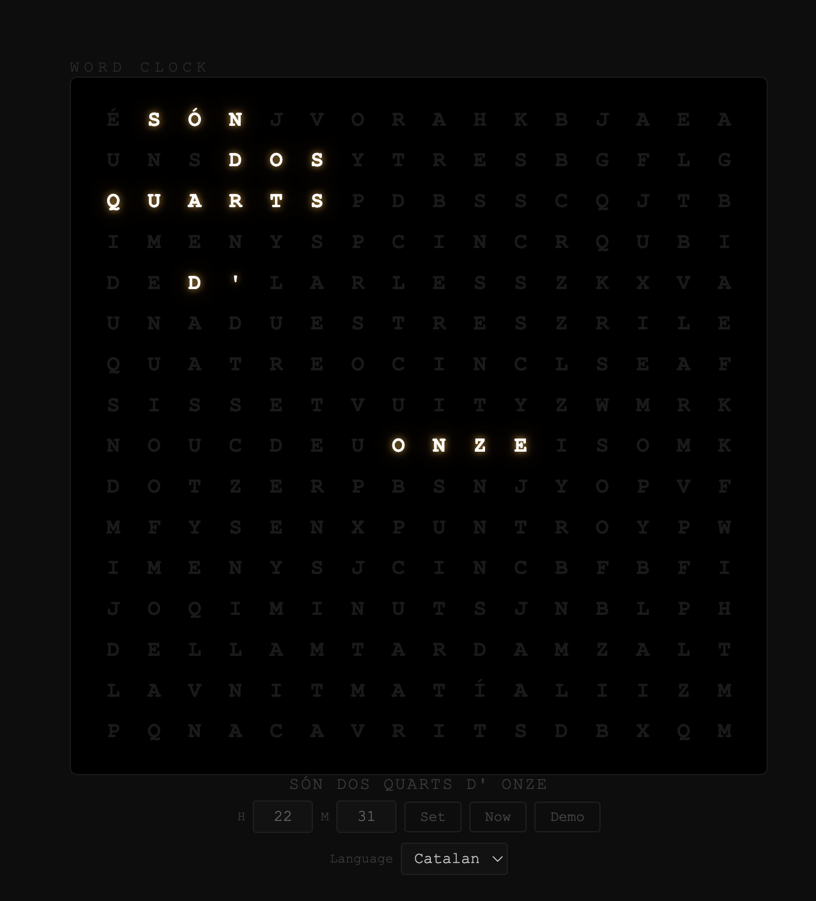

# Word Clock



> **🚧 Work in progress** — this project is under active development and not yet complete.

[](https://github.com/eballo/word-clock/actions/workflows/ci.yml) [](#) [](https://www.python.org/) [](https://fastapi.tiangolo.com/) [](https://typer.tiangolo.com/) [](https://github.com/astral-sh/uv) [](https://github.com/astral-sh/ruff) [](https://github.com/pre-commit/pre-commit) [](LICENSE)

A 50 × 50 cm word clock (IKEA SANNAHED frame) with a 16 × 16 letter matrix (1 024 WS2812B LEDs, 4 per letter) driven by a Raspberry Pi 3B with a 7" touch screen under the clock.
The front panel is 3D-printed and interchangeable, allowing the clock to display time
in different languages without any hardware changes.

## Motivation

I love the look of word clocks and have wanted one for a long time. The problem is that
most of the ones I found — whether commercial or open-source — are in English or German.
I wanted one in Catalan, and I could not find it anywhere.

So I decided to build my own. This project documents the full process step by step: the
hardware, the software, the 3D-printed panel, and everything in between. I am not an expert
in any of these areas, so things will change as I experiment and learn.

## Repository structure

```
word-clock/
├── prototype/    # Browser-based JavaScript simulator to validate the grid layout
├── wordclock/    # Python package — LED control, time logic, FastAPI + Typer CLI, web UI and OpenSCAD model
├── tests/        # Unit and integration tests
├── docs/         # Step-by-step build documentation
└── README.md
```

## Documentation

The `docs/` folder walks through the full build process:

- `01-introduction.md` — project overview and how it works
- `02-hardware.md` — components, wiring and 3D-printed panel
- `03-software.md` — setting up the Raspberry Pi, running the code and the planned kiosk
- `04-assembly.md` — putting it all together
- `05-enclosure.md` — IKEA SANNAHED frame, 3D-printed parts and STL generation
- `06-bench-test.md` — lighting a test strip under the printed test corner
- `07-mini-matrix.md` — a quick 10 × 6 matrix with the 30 LEDs/metre strip

## Ideas & Notes

This is a personal project and my first time building something like this — combining
hardware, 3D printing and software from scratch. The notes below capture what I want
to build and how I am thinking about it. Things will change as I learn.

- Add multilanguage support (Catalan, Spanish, English, Dutch) with interchangeable front panels
- Assemble the physical LED matrix inside the frame
- Set up the Raspberry Pi and configure it to run the clock automatically on boot
- Design and 3D-print the front panel with the letter grid

## Releases

See [docs/release.md](docs/release.md) for the full release history.

## Reference/Useful links

- [rpi_wordclock](https://github.com/bk1285/rpi_wordclock) — inspiration for the software and API design
- [Free fonts for 3D printing](https://en.solidmakarna.se/supportblogg/20-gratis-typsnitt-for-laserskarning)

## Acknowledgements

- [petercmonaco — WordClockSimulator](https://github.com/petercmonaco/WordClockSimulator)
